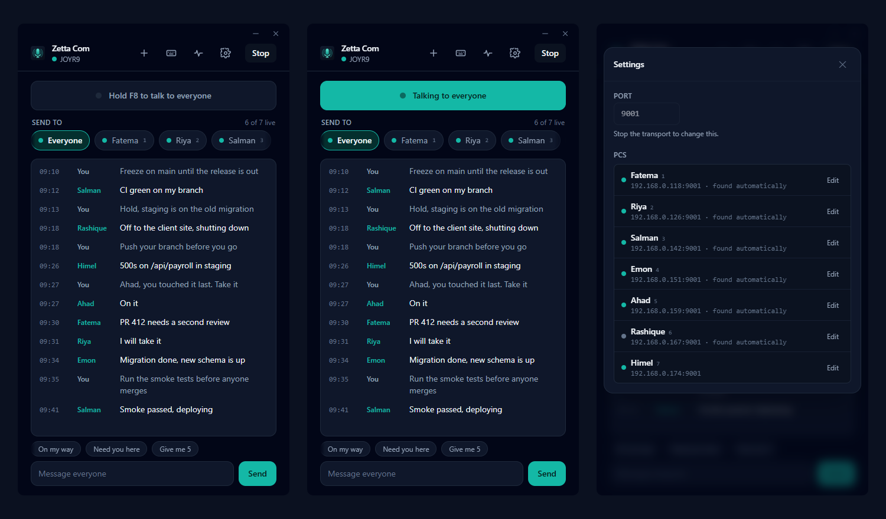

<picture>
  <source media="(prefers-color-scheme: dark)" srcset="assets/banner-dark.svg">
  
</picture>

I build systems - web, mobile, desktop and backend - from Bangladesh.

### Things I made that you can use

<table>
<tr>
<td width="50%" valign="top">

 <b><a href="https://github.com/joyahmed/devgo">DevGo</a></b> 
Every project on your machine (Windows, WSL, macOS), your GitHub repos and your servers in one launcher. One key to open an editor, terminal or dev script.
</td>
<td width="50%" valign="top">

 <b><a href="https://github.com/joyahmed/zetta-com">Zetta Com</a></b> 
A LAN intercom. Hold a key and the people you pick hear you. No internet, no accounts, no server, 2.5 MB.
</td>
</tr>
<tr>
<td width="50%" valign="top">

 <b><a href="https://github.com/joyahmed/zetta-focus-console">Zetta Focus Console</a></b> 
A focus timer you drive from the terminal. Nothing leaves your machine. 5 MB.
</td>
<td width="50%" valign="top">

 <b><a href="https://github.com/joyahmed/desk-monitor">Desk Monitor</a></b> 
Tray app that keeps one keyboard and mouse working across Windows, Linux and macOS (Deskflow).
</td>
</tr>
<tr>
<td width="50%" valign="top">

 <b><a href="https://github.com/joyahmed/gridle">Gridle</a></b> (formerly Panes) · <a href="https://youtube.com/shorts/_7JYDIkQlGg">▶ Short</a> 
Windows-style window snapping for macOS, a native Swift menu-bar app.
</td>
<td width="50%" valign="top">

 <b><a href="https://github.com/joyahmed/palimpsest">Palimpsest</a></b> 
Memory for AI agents that forgets stale facts instead of piling them up.
</td>
</tr>
</table>

### Live sites I built

- [**Zetta HRM**](https://hrm.zettabyteincorp.com/auth/signin) - HR, attendance and payroll for Bangladesh and Canada. Open the demo, no account needed.
- [**Zetta Commerce**](https://store.zettabyteincorp.com/) - online shops, each on its own domain. Next.js on an ASP.NET Core API.
- [**Zetta Decorate**](https://decorate.zettabyteincorp.com/) - pick a room, a style and a size and get a picture of the decorated room in about ten seconds.
- [**Zetta School**](https://school.zettabyteincorp.com/) - CELPIP practice with feedback, everyday English for life in Canada, and first letters in Bangla and Tamil for children.
- **Banani DOHS** [Web](https://dohsbanani.org) | [iOS](https://apps.apple.com/app/id6815309798) | [Android](https://play.google.com/store/apps/details?id=com.joyahmed007.bananidohs) - the residents' association of a Dhaka housing area. Pay the service charge, report an issue to security, find a doctor. React Native app, same rules as the web.
- [**Central Taxes Survey Zone**](https://taxsurvey.gov.bd) - the official site of a National Board of Revenue tax zone, Government of Bangladesh.

🌐 [joy.zettabyteincorp.com](https://joy.zettabyteincorp.com/) · ▶️ [YouTube @joyahmedbuilds](https://www.youtube.com/@joyahmedbuilds)
